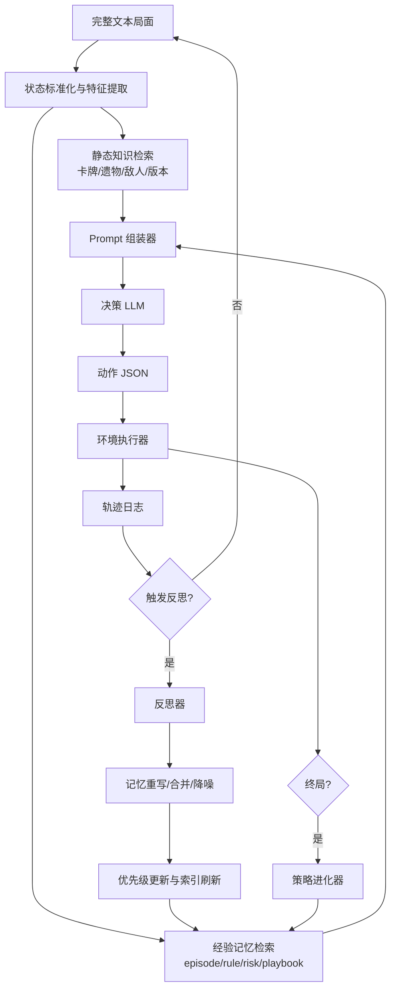
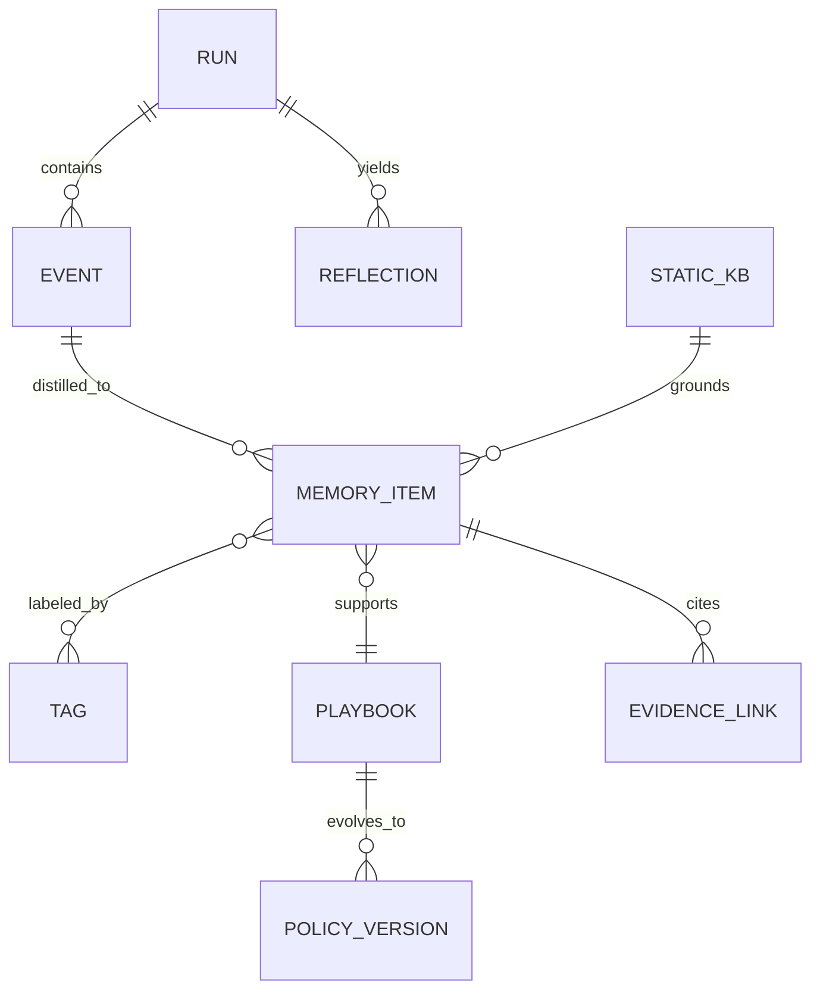

# LLM Agent 深度研究

**User:** Anonymous  
**Created:** 6/1/2026 17:43:46  
**Updated:** 6/1/2026 19:19:57  
**Exported:** 6/2/2026 10:27:15  
**Link:** [https://chatgpt.com/c/6a1d5450-2ab8-83ec-92e0-a0227a407901](https://chatgpt.com/c/6a1d5450-2ab8-83ec-92e0-a0227a407901)  

## Response:
2026/6/1 18:26:23

# 面向 Slay the Spire 2 的 LLM 代理反思进化记忆机制研究报告

**Executive Summary**

公开可检索到的“LLM 自动玩 Slay the Spire 2”资料，截至 2026 年中，仍以工程实现为主，而不是成熟的同行评审论文；其中最关键的基础设施是 STS2MCP、MCPTheSpire，以及围绕它们构建的 TokenSpire2、sts2-llm、STS2-Agent 等项目，这些系统已经能够把战斗、路线、奖励、商店与菜单等局面转成文本状态并执行动作。[^1]

更广泛的学术证据显示，在文本交互环境中，真正的瓶颈通常不是“看不见状态”，而是长程推理、跨回合/跨局经验迁移、稳定检索和测试时自我改进；AgentBench、GameBench、ALFWorld、ScienceWorld 与 Jericho 都把这些问题暴露得很清楚。[^2]

对复杂回合制或卡牌代理而言，效果最稳定的路线并不是把每一步都丢给一个独立 prompt，而是把**显式记忆、外部知识检索、关键节点搜索/规划、赛后反思、经验回放与慢速策略演化**组合起来；PokéLLMon、PokéChamp、Hearthstone 的 MCTS/进化方法，以及 ReAct、Reflexion、LATS、Voyager、CER、EvoTest 等工作都支持这一判断。[^3]

结合你当前的 headless、完整文本状态环境，我建议的落地路径是：**先做“经验库 + 优先回放 + 反思重写”的双层记忆 MVP，再升级到“工具化分层记忆 + 策略池进化”的生产级架构**。前者解决“单局稳定性 + 跨局学习”，后者解决“长期一致性 + 迁移能力 + 版本演化”。这一设计直接吸收了 Reflexion、RMM、Hindsight、A-Mem、AgeMem、ALMA、MCMA、AgentHER 与 EvoTest 的强项。[^4]

最重要的工程结论是：**不要把原始对话历史、完整 CoT 或整段回合日志直接当长期记忆**；在你的环境里，当前局面的完整文本已经承担了“工作记忆/感知输入”的任务，长期记忆应该只保存结构化 lesson、失败模式、路线策略、敌人知识、构筑计划与版本化规则，而且要把“证据”和“推断”分开存。[^5]

## 关键方案总览

| 方案名 | 记忆类型 | 更新频率 | 检索策略 | 优点 | 缺点 | 实现复杂度 | 推荐场景 |
|---|---|---|---|---|---|---|---|
| 单步独立 prompt | 无显式长期记忆，仅当前状态 | 每步 | 不检索 | 最简单、最稳、最易并行与调试 | 长期策略漂移大；跨战斗、跨楼层、跨局几乎不学习 | 低 | MVP、接口联调、状态序列化验证 |
| 伪记忆摘要 | 短摘要型工作记忆 | 每数步或每阶段 | 直接拼接摘要 | 成本低；对路线/商店/休息点决策已有帮助 | 强烈依赖摘要质量；容易丢失关键约束；摘要污染会持续扩散 | 低到中 | 早期可用版、对局节奏较慢的非战斗阶段 |
| 仅出牌阶段多轮 QA | 战斗局部短时记忆 | 每回合/每张牌 | 直接使用当前 QA 上下文 | 对连招、能量分配、目标选择更好 | 只提升战术层；战斗外无帮助；跨战斗不沉淀经验 | 中 | 以战斗操作为主、卡序复杂的局面 |
| 经验库 + 优先回放 + 反思重写 | 情景记忆 + 规则记忆 + 风险记忆 | 轻量每步写日志，重写在战斗后/关键节点/局后 | 结构化过滤 + 向量检索 + 优先级回放 | 最适合你当前环境；显著提升跨局学习；不需要训练模型参数 | 需要设计 memory schema、打分、合并、衰减与验证 | 中到高 | 推荐的首选方案；先做成 MVP 再扩展 |
| 工具化分层记忆 + 策略池进化 | STM/LTM 一体化 + playbook 池 + 元记忆 | 每步可显式调用 memory tool，策略池按局演化 | 检索由控制器决定，支持摘要/存取/丢弃/版本化 | 长期一致性最好；可迁移；可做自动 forgetting、自动抽象与策略演化 | 系统设计复杂；需要更多日志与评估基础设施 | 高 | 生产级、多角色多版本、多模型长期运营 |
| 关键节点搜索增强器 | 临时搜索树/候选动作评估 | 只在高不确定或高价值节点 | 候选动作生成 + 局部 lookahead | 在 Boss、精英、复杂手牌时提升大 | 额外延迟明显；若全局开启成本过高 | 中 | 和上两种记忆方案组合，而不是单独使用 |

表中“经验库 + 优先回放 + 反思重写”主要受 Reflexion、CER、AgentRR、AgentHER、Sweet&Sour 与 RMM 启发；“工具化分层记忆 + 策略池进化”则更接近 AgeMem、ALMA、MCMA、Voyager、EvoTest 与 PokéChamp 所体现的方向。[^4]

## 系统性综述

**与 StS2 最贴近的公开工程现实。** 直接针对 Slay the Spire 2 的公开资料，目前最成熟的是一批开源工程而不是论文。STS2MCP 已经把游戏状态和动作暴露成 localhost REST API 与可选 MCP server，支持单人与多人、菜单控制、角色选择、地图推进、战斗出牌、奖励领取、药水使用等；它还提供 `get_game_state(markdown/json)`、`search_wiki`、`get_compendium` 等接口。MCPTheSpire、早年的 CommunicationMod 与 spirecomm 则提供了 Slay the Spire 一代类似的“文本状态 + 外部进程控制”模式。对你给定的 headless 文本环境而言，这说明接口层已经不是主要难点，真正的难点转移到了决策编排、记忆组织和经验复用。[^1]

**中文工程实践已经出现了“复盘—记忆—再开局”的雏形。** TokenSpire2 明确把每个决策点序列化为结构化文本，并在每局结束后执行反思、更新会话级记忆文件；sts2-llm 则提出了四层记忆系统，包括当前 run playbook、近期 run timeline、完整复盘 archive 和跨局 lesson ledger，并强调“读状态→执行一张牌→重新读状态”的安全协议；STS2-Agent 进一步展示了本地小模型在 STS2MCP 上做 observe-think-act 循环的最小可运行形态，并限制每个状态只暴露 1–3 个工具以降低小模型失焦风险。[^6]

**文本环境的研究启示和你的环境高度同构。** ALFWorld 证明了“先在文本抽象空间学策略，再执行到更具体环境”是有效范式；ScienceWorld 则说明，即便是很强的静态模型，如果缺少交互式环境中的可复用推理，也会输给更小的交互训练代理；Jericho 把文本游戏明确定位为 combinatorial action space、commonsense reasoning 和 long-horizon planning 的挑战环境。你的 headless STS2 环境比视觉游戏更友好，因为它已经把可见状态全部文本化了，但这并不自动解决长程信用分配、策略一致性和经验复用问题。[^7]

**基准层面的共识也支持“记忆优先”而不是“仅靠 prompt”。** AgentBench 把 poor long-term reasoning、decision-making 与 instruction following 视为 LLM 代理的主要障碍；GameBench 则显示，即便加上 CoT 或 RAP，模型与人类在战略游戏上的差距仍然明显，某些情况下 GPT-4 甚至可能比随机动作更差。这对于 StS2 的意义非常直接：越是路线选择、稀有卡取舍、店铺购买、Boss 前资源管理这种需要长期一致性的决策，越不能只靠单步 prompt 的即时聪明。[^2]

**复杂卡牌游戏研究给出的是“混合范式”，不是单一范式。** Hearthstone AI Competition 明确把随机性、卡牌协同、隐藏信息与巨大牌组空间视为核心难点；后续工作一方面用 MCTS + supervised value guidance 来提升胜率同时降低计算量，另一方面也出现了通过改进技术在人类对战中击败顶级玩家的系统，甚至还有通过竞争性协同进化训练 agent 的进化算法方案。更重要的是，Tales of Tribute 作为 deck-building 竞赛环境，明确指出相较普通 CCG，牌库在对局中持续构筑，因而更强调长期规划与灵活性——这和 StS/STS2 的“边打边构筑”特性高度一致。[^8]

**LLM 进入复杂回合制/对抗游戏之后，最好的公开案例已经不是“纯聊天”了。** PokéLLMon 通过三件事做出成绩：战斗反馈驱动的 in-context reinforcement learning、外部知识增强生成，以及用 self-consistency 缓解 panic switching；它在人类对战中达到了接近 human-parity 的水平。PokéChamp 则更进一步，把 LLM 放进 minimax 框架中，替代动作采样、对手建模和值函数三个模块，并显著超过先前的 LLM bot 与强规则基线。这两条路线说明：**纯 prompt LLM 可以上场，但一旦进入复杂策略博弈，最佳效果通常来自“LLM + 搜索/对手建模/知识检索”的混合系统。** 这对 StS2 的启示是，记忆系统不应只是“存文本”，而应和候选动作生成、局部搜索、风险估值协同。[^3]

**思维链、反思、搜索和技能库是四条互补的推理强化线。** CoT 说明结构化中间推理能提升复杂推理任务表现；ReAct 把 reasoning traces 和 actions 交错，显著提升 ALFWorld 与 WebShop 等互动任务；Self-Refine 用单模型“生成—反馈—改写”迭代提升质量；ToT 与 LATS 则把 test-time exploration 显式引入推理；Voyager 进一步展示了自动课程、技能库和环境反馈迭代编程如何形成长期复合能力。对 StS2 而言，这些工作共同说明：战斗内出牌、路线选择、商店购买、事件抉择，应该共享同一套“行动前检索—行动后反思—跨局复用”的回路，但推理粒度可以不一样。[^9]

**长期记忆研究已经从“把历史塞进 prompt”转向“把记忆视为一等公民”。** MemoryBank 引入带遗忘曲线的长期记忆；MemGPT 借鉴操作系统的多级存储；Mem0 强调动态提取、整合和检索 salient 信息，并报告相对 full-context 的显著延迟与 token 成本优势；A-Mem 采用 Zettelkasten 风格的动态链接记忆；RMM 强调前瞻式摘要和后顾式检索优化；Hindsight 则很重要地指出，很多系统混淆了 evidence 与 inference，因此应该把世界事实、经验、实体摘要和信念分网存储。LangMem/LangGraph 把语义、情景和程序记忆清晰区分，而《Memory in the Age of AI Agents》进一步把 agent memory 的 forms、functions 与 dynamics 体系化了。对于你的系统，这些结论几乎可以直接转成工程原则：**静态游戏知识、运行经验、策略规则和临时工作记忆不要混存。** [^10]

**“反思”和“演化”这两个方向，近两年的进展尤其直接可用。** Reflexion 把语言反馈写进 episodic memory buffer；Sweet&Sour 证明仅从失败反思并不够，成功经验也应该强化；CER 给出 training-free 的 contextual experience replay；AgentRR 把 record-and-replay 引入 agent 框架；AgentHER 把失败轨迹重标为“可达成的替代目标”以提高样本效率；AgeMem 把存、取、改、删、总结等 memory ops 变成 agent 可调用的工具；ALMA 和 MCMA 把“如何设计记忆结构与抽象层级”交给元学习；EvoTest 则把整个 agent 配置——包括 prompt、memory、超参数与工具使用——作为进化对象。BenchTrace 最新显示，很多自演化代理的问题不是“没有反思”，而是**诊断质量不足、噪声积累导致早期教训被遗忘，以及反思无法跨上下文泛化**。这正是你要避免的坑。[^4]

**商业与基础设施层面的现实是：游戏侧“自动打牌”产品少，记忆与 agent 平台产品更多。** 在游戏平台侧，NVIDIA ACE 已明确转向能感知、规划并执行动作的 autonomous game characters，DeepMind 的 SIMA/SIMA 2 则面向跨游戏泛化的通用游戏代理；而在 agent 基础设施侧，LangGraph 提供 JSON/namespace 形式的长期记忆存储，Amazon Bedrock AgentCore Memory 支持 built-in、override 与 self-managed 三类记忆策略，Zep 提供基于 temporal knowledge graph 的 sub-200ms context serving，Mem0 则同时提供开源与托管记忆层。对于 StS2 玩家代理，这些产品最现实的价值不是“替你设计策略”，而是提供**记忆底座、检索层与 observability**。[^11]

## 现有三种实现对比

你的三种基础实现并不是“谁对谁错”，而是分别占据了**不同的复杂度—收益曲线**。

**单步独立 prompt** 的最大优势是工程上最干净。它极易并行、极易重放、极易做 A/B 测试，也最方便你先把状态文本、动作约束、格式解析和错误恢复跑通。它特别适合路由、菜单、简单奖励选择这类“当前状态几乎决定最优动作”的节点。但是，从 AgentBench、GameBench 到文本游戏基准，长期推理恰恰是最脆弱的部分；如果所有楼层都被当作“第一次见”，那么 deck plan、Boss 准备、药水保留、删卡优先级和精英规避策略会持续抖动。[^2]

**伪记忆摘要** 是一个很强的过渡型设计。它用小成本把“最近发生了什么”“当前构筑想往哪里走”“有什么风险”塞回 prompt，对非战斗阶段尤其有效，因为路线和商店决策更依赖宏观计划而非每张牌的瞬时排列。问题也很典型：总结器一旦把信息压错，后续每一步都在错误抽象上继续推理；而且摘要往往混淆事实与结论，例如把“这把缺伤害成长”与“所以必须放弃所有防御卡”写在一起，后者未必成立。Hindsight 对 evidence / inference 混淆的批评，在这里几乎就是逐字命中。[^12]

**仅在出牌阶段做多轮 QA** 是“局部效果最好、全局收益有限”的策略。它非常适合 StS 类战斗，因为很多战术质量就取决于**能否记住上一张牌、剩余能量、触发条件、敌人 intent 变化、手牌索引变化**。现有 STS2 工程项目也反复强调“单步动作 + 重新读状态”的安全模式，以避免执行多动作后状态漂移。问题在于，这种记忆只在战斗子问题里成立，几乎无法沉淀成跨战斗的构筑经验，更不会自动改善路线、商店、火堆与事件选择。[^13]

如果按**适用场景**排序，我会这样建议：在今天就要稳定跑通的情况下，保留“单步独立 prompt”做所有节点的兜底；在战斗节点叠加“多轮 QA”提升 tactical quality；然后优先把“伪记忆摘要”升级成真正的结构化经验 memory，而不是继续堆更长摘要。原因很简单：从文献和工程两边看，**真正能带来跨局提升的不是‘更长上下文’，而是‘更可靠的记忆写入、检索和重写机制’**。[^14]

从**可扩展性**看，单步 prompt 的扩展上限最低，因为任何新增能力都只能通过 prompt 工程硬塞进去；伪记忆摘要在中期还能继续活，但最终一定会碰到“摘要临界点”，即再压缩就失真、再详细就太贵；出牌多轮 QA 能长期保留，但它更像一个战术插件，而不是整个 agent 的长期学习骨架。对你要做的“反思进化记忆机制”，最佳底座是第二种的“有意识地保留过去”，但必须从自然语言摘要升级为**typed memory**。这一点与 LangMem 对 semantic / episodic / procedural 的区分、AgeMem 对 memory operations 的工具化、以及 ALMA/MCMA 对记忆设计本身可学习的结论是一致的。[^5]

从**计算与延迟**看，单步 prompt 最便宜；伪记忆摘要会引入摘要维护成本，但通常仍显著低于完整历史拼接；出牌多轮 QA 的最坏延迟最高，因为它在最频繁的决策阶段增加了模型回合数。现有本地 STS2-Agent 的一个自报 datapoint 是：Qwen3.5-27B Q4_K_M 在 RTX 4090 上，速度约为每动作 10 秒，这足以说明如果你把“多轮互动 + 长上下文 + 搜索”无差别加到所有节点，体验很容易变差。更稳的做法是把昂贵步骤限制在**关键状态**。[^15]

## 反思进化记忆设计

先给出一条总原则：**在你的环境中，当前局面的完整文本已经是“工作记忆”，长期记忆不应该重复保存它，而应该保存“未来还会用到的压缩经验”。** 我建议把系统拆成两层：第一层是**静态知识层**，存版本化游戏知识，如卡牌文本、升级差异、敌人/精英/Boss 行为摘要、事件与商店规则；第二层是**经验记忆层**，存这台代理自己在数百局中形成的 lesson、失败模式和 playbook。STS2MCP 已经提供 `search_wiki` 与 `get_compendium` 之类的知识接口，而 Hindsight、LangMem 与 Mem0 的共同经验则是：把检索证据和代理推断分开，会更稳、更可解释。[^16]

**架构 A：经验库 + 优先回放 + 反思重写。** 这是我最推荐的首发架构，因为它不要求权重训练，能直接建立在你现有三种实现之上。其核心做法是：每一步只做轻量 event log；在战斗结束、卡牌奖励、商店退出、路线提交、精英/Boss、死亡/胜利、重复失误等关键节点，再启动反思器把轨迹蒸馏成结构化记忆条目。记忆条目不直接存长段自然语言，而是存成四类：`fact`（静态/版本化知识引用）、`episode`（关键片段与上下文）、`rule`（可复用 heuristic）、`risk`（失败模式与禁忌）。检索时先按角色、职业、楼层、Act、当前 HP 档位、构筑 archetype、即将面对的敌人/Boss、商店/火堆/战斗阶段做结构化过滤，再做向量召回与优先级排序；排序分数建议由**相似度 × 结果增益 × 支持次数 × 新鲜度 × 置信度**组成。这个设计直接融合了 Reflexion 的 verbal feedback、CER 的 contextual replay、AgentRR 的 record-and-replay、AgentHER 的失败重标，以及 Sweet&Sour 对成功经验的强化。[^4]

**架构 B：工具化分层记忆 + 策略池进化。** 这是面向中长期的生产级路线。它不再把“写记忆/读记忆/压缩记忆/丢弃记忆”看成系统外逻辑，而是把它们变成 LLM 可以显式调用的 memory tools；再在更慢的时间尺度上维护一个**playbook/policy pool**，把反复成功的局部 heuristic 升级成面向构筑和路线的慢变量策略。AgeMem 给出了 memory 操作工具化的明确框架，ALMA 与 MCMA 说明“记忆怎么抽象、按哪一层级迁移”本身可以被学习和搜索，EvoTest 则说明 prompt、memory、工具习惯和超参数可以一起被跨 episode 地进化。对 StS2 而言，这种进化不是 self-play，而是“跨 seed / 跨角色 / 跨版本 / 跨 Ascension 的策略族演化”。每局结束后，系统会生成一个 `policy_delta`：哪些 lesson 得到强化、哪些 playbook 被证伪、哪些检索阈值和工具预算该改，然后通过 bandit/Elo/淘汰赛方式选择下一轮 run 的默认 playbook。[^17]

**为什么我建议先 A 后 B。** 架构 A 最大的价值是，它几乎不改变你现有决策线程，只是把原本松散的“伪记忆/复盘文本”升级成结构化的可检索经验库；你可以先在“战斗后 + 局后”两种 trigger 上落地。架构 B 的收益更大，但必须建立在你已经有**可重放日志、memory schema、检索指标、回放评估、版本控制和失败类别标注**的基础上，否则“策略池进化”会沦为不可解释的 prompt 漂移。BenchTrace 最新结果提示，很多自演化代理的问题恰恰出在“有 evolution，但没有高质量 diagnosis 和受控验证”。[^18]

下面给出我建议的关键流程图。



这个流程里，**决策线程必须做轻，反思线程可以做重**。原因一方面来自工程现实：本地小模型在 STS2 中已经可能接近每动作 10 秒，另一方面来自 Mem0、Zep 等记忆系统的经验——检索应足够快、足够窄，而不是让主决策线程为 memory maintenance 付主要的延迟。[^15]

再给出一个实体关系图，帮助你从存储层设计 memory schema。



**推荐的记忆条目格式。** 不建议只用一个 `summary` 字段；建议从一开始就做 typed schema，否则以后很难做合并、降级、版本迁移和冲突检测。下面是一份可直接落地的 JSON Schema 草案。

```json
{
  "$schema": "https://json-schema.org/draft/2020-12/schema",
  "title": "StS2MemoryItem",
  "type": "object",
  "required": [
    "memory_id",
    "memory_type",
    "scope",
    "game_version",
    "character",
    "phase",
    "state_signature",
    "content",
    "outcome",
    "quality"
  ],
  "properties": {
    "memory_id": { "type": "string" },
    "memory_type": {
      "type": "string",
      "enum": ["fact", "episode", "rule", "risk", "playbook", "counterfactual"]
    },
    "scope": {
      "type": "string",
      "enum": ["turn", "combat", "floor", "run", "cross_run"]
    },
    "game_version": { "type": "string" },
    "character": { "type": "string" },
    "ascension": { "type": "integer" },
    "phase": {
      "type": "string",
      "enum": ["combat", "map", "reward", "shop", "rest", "event", "menu"]
    },
    "state_signature": {
      "type": "object",
      "properties": {
        "act": { "type": "integer" },
        "floor": { "type": "integer" },
        "hp_ratio_bucket": { "type": "string" },
        "deck_archetype": { "type": "string" },
        "boss_hint": { "type": "string" },
        "enemy_tags": { "type": "array", "items": { "type": "string" } },
        "route_tags": { "type": "array", "items": { "type": "string" } }
      }
    },
    "content": {
      "type": "object",
      "properties": {
        "observation": { "type": "string" },
        "lesson": { "type": "string" },
        "action_pattern": { "type": "string" },
        "anti_pattern": { "type": "string" },
        "counterfactual": { "type": "string" }
      }
    },
    "evidence_refs": {
      "type": "array",
      "items": { "type": "string" }
    },
    "outcome": {
      "type": "object",
      "properties": {
        "result_tag": { "type": "string" },
        "hp_delta": { "type": "number" },
        "gold_delta": { "type": "number" },
        "deck_value_delta": { "type": "number" },
        "run_survival_delta_est": { "type": "number" }
      }
    },
    "quality": {
      "type": "object",
      "properties": {
        "confidence": { "type": "number" },
        "support_count": { "type": "integer" },
        "contradiction_count": { "type": "integer" },
        "last_used_at": { "type": "string" },
        "recall_success_rate": { "type": "number" }
      }
    },
    "retrieval_hints": {
      "type": "object",
      "properties": {
        "keywords": { "type": "array", "items": { "type": "string" } },
        "priority": { "type": "number" },
        "ttl_runs": { "type": "integer" }
      }
    }
  }
}
```

**示例 memory item。** 这个例子体现的是“事实、 lesson 与风险分离”。

```json
{
  "memory_id": "mem_run124_floor16_bossprep_01",
  "memory_type": "rule",
  "scope": "run",
  "game_version": "0.103.2",
  "character": "Ironclad",
  "ascension": 0,
  "phase": "map",
  "state_signature": {
    "act": 1,
    "floor": 16,
    "hp_ratio_bucket": "0.45-0.60",
    "deck_archetype": "thin_block_plus_scaling_missing",
    "boss_hint": "unknown_act1",
    "enemy_tags": [],
    "route_tags": ["rest_available", "shop_available", "elite_optional"]
  },
  "content": {
    "observation": "在缺乏稳定伤害成长时，强打 Act 1 精英/ Boss 前的高风险路线会放大牌组上限不足。",
    "lesson": "如果永久成长缺失且生命低于 60%，优先商店删卡/补成长，再走休息点，不要为了短期奖励强拿精英。",
    "action_pattern": "shop_remove > scaling_pick > elite_avoid",
    "anti_pattern": "low_hp_greed_elite_without_scaling",
    "counterfactual": "如果此前拿到力量成长或可持续 AoE，可以重新开放精英路线。"
  },
  "evidence_refs": [
    "run124:f09",
    "run124:f13",
    "run124:f15"
  ],
  "outcome": {
    "result_tag": "survived_to_boss_but_lacked_damage",
    "hp_delta": -31,
    "gold_delta": 112,
    "deck_value_delta": 0.18,
    "run_survival_delta_est": 0.07
  },
  "quality": {
    "confidence": 0.78,
    "support_count": 4,
    "contradiction_count": 1,
    "last_used_at": "2026-06-01T10:45:00+08:00",
    "recall_success_rate": 0.66
  },
  "retrieval_hints": {
    "keywords": ["low hp", "act1 boss prep", "missing scaling", "shop first"],
    "priority": 0.84,
    "ttl_runs": 40
  }
}
```

**建议的 prompt 交互方式。** 重点不是让模型“多说”，而是让它在**全状态 + 少量高质量记忆 + 明确动作约束**下做决策。

```text
[System]
你是一个 Slay the Spire 2 玩家代理。
你的任务不是解释游戏，而是做当前局面的最佳动作。
必须遵守：
1. 只能依据给定状态与检索结果做决定。
2. 若检索到的 memory 与当前状态冲突，以当前状态为准。
3. 输出必须是 JSON。
4. 如果不确定，请返回 uncertainty，并选择最稳妥动作。

[Static Knowledge]
{{retrieved_kb_items}}

[Reusable Memories]
{{top_rule_memories}}
{{top_risk_memories}}
{{top_episode_memories}}

[Current Full State]
{{full_state_text}}

[Output Schema]
{
  "action": "...",
  "target": "...",
  "reason_brief": "...",
  "used_memory_ids": ["..."],
  "uncertainty": 0.0
}
```

赛后反思 prompt 则应强制要求“事实—原因—可复用规则—反例边界”四段输出，避免空泛鸡汤式总结。

```text
请根据以下轨迹生成结构化反思。
要求：
1. 区分 observation / diagnosis / reusable_rule / anti_pattern / counterfactual。
2. 只提炼未来可复用的信息。
3. 如果只是当前局独有偶然事件，不要升格为长期规则。
4. 同时提取正面经验和负面经验。
5. 输出 JSON 数组。

[Trajectory Span]
{{trajectory_text}}

[Current Memory Candidates]
{{similar_existing_memories}}
```

**触发条件建议。** 我建议分三级。一级是**轻量记录**：每一步永远写 event log，但不做 LLM 反思。二级是**中等反思**：战斗结束、卡牌奖励、商店退出、路线承诺、休息点、药水使用、HP 大幅波动、出现重复无效动作。三级是**重反思/重写**：精英、Boss、死亡、胜利、连续同类失败、构筑 archetype 明显变化。RMM 的多粒度摘要、Sweet&Sour 的正负经验双通道，以及 BenchTrace 对“诊断质量”重要性的发现都支持这种分级触发，而不是每一步都重反思。[^19]

**更新规则建议。** 初始写入时所有 rule 都只是候选，不直接成为高优先级长期规则。只有在多局、多 seed 上被重复命中并带来正增益时，才提升为 `playbook fragment`；若与新证据冲突，则计算 contradiction_count 并尝试重写或降级。MemoryBank 的“遗忘/强化”，A-Mem 的“链接与演化”，以及 Hindsight 对结构化网络的强调都说明：长期有效的记忆系统一定需要**合并、衰减、链接和反证处理**。[^10]

**并发与延迟处理建议。** 决策线程只做三件事：取当前状态、检索少量记忆、调用一次决策模型。反思、合并、排序、向量化、策略池演化都放到队列后处理。现有 STS2 工程已经非常强调动作索引漂移、循环与无效调用等问题，所以我建议继续坚持“单动作提交 + 重新读状态”的原则；战斗阶段即便开启多轮 QA，也只允许一轮真正执行，剩余轮次都发生在执行前。[^13]

**可视化与调试建议。** 至少做六个面板：一是 run timeline，可回放每层状态与动作；二是 memory browser，查看每条 lesson 的来源、支持数、被谁命中；三是 retrieval inspector，展示为什么这几条 memory 被召回；四是 contradiction dashboard，专门跟踪互相打架的规则；五是 policy genealogy，看 playbook 如何从 run 复盘中演化；六是 latency/token 面板，拆开“检索—决策—执行—反思”的耗时占比。若你未来接入 Zep、Mem0 或 AgentCore，这些面板会更容易做，因为这些平台天然强调 context assembly、memory strategy 与 observability。[^20]

## 实验与评估计划

**评估要分成“赢没赢”“为什么赢”“是否真学会了”三层。** 只看胜率会把很多问题掩盖掉，比如模型可能只是更保守、活得更久，但从不成型；也可能记忆被频繁检索，但实际上没有改变行为。AgentBench、GameBench 与最新的 BenchTrace 一个共同启示是：**任务成功率只是结果指标，长期策略质量与反思/进化质量必须单独测。** [^2]

建议的核心量化指标如下。

| 指标 | 定义 | 说明 |
|---|---|---|
| 胜率 | 完成整局胜利的比例 | 主指标 |
| 平均到达层数 / Act | 每局到达的最高楼层或幕数 | 适合早期样本不足时使用 |
| 平均战斗回合数 | 普通战/精英/Boss 的平均回合数 | 过长可能表示输出不足，过短可能表示鲁莽 |
| 关键资源效率 | 每层平均失血、药水转化收益、商店金币效率 | 衡量宏观资源管理 |
| 构筑成型度 | 达成目标 archetype 的一致性、关键牌/遗物命中率 | 衡量长期计划能力 |
| 策略多样性 | 不同 seed 上 playbook 分布熵、动作熵 | 防止只学会一套僵化打法 |
| 记忆利用率 | 召回 memory 被真正使用且改变行动的比例 | 不是“被塞进 prompt”而已 |
| 记忆命中增益 | 使用 memory 后相对无记忆基线的结果提升 | 可做 paired 比较 |
| 失败避免率 | 相同失败模式再次出现时被规避的比例 | 参考 BenchTrace 的 FAR 思路 |
| 样本效率 | 达到同等胜率所需 run 数 | 评估“会不会越打越会” |
| 推理延迟 | 每步决策、每次反思、每局总 token/延迟 | 工程可用性指标 |

其中，“失败避免率”我建议直接借鉴 BenchTrace 的 Failure Avoidance Rate 思路，把 StS2 的失败模式细分成诸如“低血贪精英”“缺成长硬打 Boss”“手牌索引漂移导致误打”“药水长期囤积未使用”“重复买低价值卡导致牌组稀释”等标签，然后看代理在后续 run 中是否显著避免同类失败。BenchTrace 的价值恰恰在于，它提醒我们要直接测“反思是否转化成行为避免”。[^18]

**对照实验建议。** 第一组对照，就是你当前三种实现作为三条基线。第二组对照，是在结构化 memory 架构内做“有无反思”“有无优先回放”“有无成功经验写入”“有无静态 KB 检索”“有无 playbook 层”的比较。第三组对照，是“full history prompt stuffing vs typed memory retrieval”，因为 Mem0、Hindsight、RMM 都说明，盲目堆历史并不是最稳的长期方案。[^14]

**消融实验建议。** 我会优先做以下消融：去掉成功经验，只保留失败反思；去掉 episode memory，只保留 rule memory；去掉 risk memory；去掉静态 `search_wiki/get_compendium` 知识检索；去掉策略池，只留记忆库；去掉记忆重写，只做 append-only；去掉关键节点搜索，只保留一次决策。Sweet&Sour、PokeLLMon、PokéChamp 和 LATS 都暗示：成功经验、知识检索和局部搜索往往不是“锦上添花”，而是决定系统上限的关键构件。[^21]

**实验切分建议。** 不要只测随机在线 run。最佳做法是构造四套 seed：训练 seed、调参 seed、固定公开测试 seed、完全未见 seed；再在不同角色、不同升天、不同游戏版本上分层采样。EvoTest 的 J-TTL 说明，在 test-time learning 问题里，“同一个环境多次尝试会不会学会”本身就是重要维度，所以你还应额外做一套 repeated-seed curriculum：同一 seed 连打 N 次，观察 performance curve 是否上升。[^22]

**统计显著性建议。** 胜率和失败避免率用 paired seed 设计后做 McNemar 检验或 bootstrap 置信区间；层数、失血、回合数等连续指标可以做 paired bootstrap 或 Wilcoxon signed-rank；多模型/多方案比较用 Holm–Bonferroni 做多重校正。除了 p 值，建议固定报告 effect size，因为在高随机性 roguelike 环境里，效果大小通常比“显著不显著”更重要。

**训练与在线部署周期建议。** MVP 阶段不做参数训练，只做 memory accumulation；建议先收集 200–500 局，足够支持首轮 rule consolidation。增强阶段可以每 50 局做一次 memory compaction 与 playbook 重写。生产级阶段再考虑更慢周期的策略池进化，按游戏版本分 namespace，必要时接入 Agent Lightning 这类“execution 与 RL training 解耦”的框架，针对固定角色或战斗子任务做轻量参数优化。[^23]

## 实现步骤与工程细节

下面给一条我认为最现实的分阶段路线。

| 阶段 | 核心目标 | 必需模块 | 可选模块 | 产出 |
|---|---|---|---|---|
| MVP | 跑通“记录—反思—检索—再决策”闭环 | 状态标准化、事件日志、结构化 memory store、轻量检索器、局后反思器、离线评估器 | 战斗多轮 QA 保留 | 第一版跨局学习代理 |
| 增强版 | 把 memory 从“会存”变成“会用” | 优先回放、静态 KB 分层、memory merge/forgetting、关键节点反思、A/B harness、可视化面板 | 关键节点搜索器、成功经验通道 | 稳定提升 win rate / FAR |
| 生产级 | 长期演化、版本管理、运维可观测 | 策略池、memory tool controller、versioned namespace、反证与回滚、灰度部署、指标看板 | RL/微调、bandit 选择器、托管记忆平台 | 可持续迭代的长期玩家代理 |

**MVP 的最小模块。** 你只需要六个模块：`StateNormalizer`、`TrajectoryLogger`、`ReflectionWriter`、`MemoryStore`、`MemoryRetriever`、`DecisionOrchestrator`。其中 `MemoryStore` 建议一开始就拆成两张表或两个 namespace：`static_kb` 和 `experience_memory`。不要把卡牌文本、敌人知识和 run 经验塞到同一堆向量里。STS2MCP 已经提供 markdown/json game state 与 profile/wiki/compendium 接口，这意味着 static knowledge 至少有一部分可以直接外取，而不必重复让模型瞎记。[^16]

**MVP 的关键伪代码。**

```python
def agent_step(run_id: str):
    state = observe_full_state()                  # 来自 headless 文本环境
    norm = normalize_state(state)                 # 提取 act/floor/hp/archetype/enemy_tags 等
    kb_items = retrieve_static_kb(norm, top_k=4)  # 卡牌、遗物、敌人、版本规则
    mem_items = retrieve_experience(norm, top_k=6)
    prompt = build_decision_prompt(state, kb_items, mem_items)
    decision = llm_decide(prompt)                 # 只返回结构化 JSON
    result = execute_action(decision)
    append_event_log(run_id, state, decision, result)

    if should_reflect_light(state, result):
        enqueue_reflection(run_id, span="recent")

    if result.is_terminal:
        enqueue_reflection(run_id, span="full_run")
```

**反思器与记忆重写器的伪代码。**

```python
def reflection_worker(job):
    traj = load_trajectory(job.run_id, job.span)
    similar = retrieve_similar_memories(traj)
    reflection = llm_reflect(traj, similar)

    new_items = parse_structured_reflection(reflection)
    validated = verify_items(new_items)  # 检查是否与当前状态或静态知识冲突
    merged = merge_or_insert(validated)  # 相似规则合并，冲突规则降级
    rescore_priorities(merged)           # relevance * gain * support * recency * confidence

    if job.span == "full_run":
        evolve_playbooks(job.run_id)
```

**增强版的两个关键升级点。** 第一是**优先回放**：不是所有记忆都值得进 prompt，而是只让“高相似 + 高影响 + 高置信 + 高新鲜”条目进入。第二是**证据—推断分离**：比如某回合面对某 Boss 的状态文本是证据，“这把缺成长因此不能打精英”是推断；二者必须分别存储并分别更新。Hindsight 对这种分离的强调非常值得直接照搬。[^12]

**生产级阶段的慢变量是 playbook，不是原始记忆。** 也就是说，最终进入跨局策略选择器的，不该是几千条碎片 lesson，而应是几十个可解释的 playbook，例如“瘦牌稳健路线”“缺成长保血优先”“精英驱动贪收益”“特定 Boss 前高价值升级”等。playbook 来源于 memory，但高于 memory。Voyager 的 skill library、AgeMem 的 toolized memory ops 与 EvoTest 的 agent configuration evolution，都表明“真正可迁移的是被压缩后的策略单元”。[^24]

**资源估算。** 如果你用远程 API 模型，MVP 可以完全不需要 GPU；一台普通 8 vCPU / 16–32GB RAM 的服务机，配 PostgreSQL + pgvector 或同类向量检索就够了。若你用本地中型模型，则 STS2-Agent 的公开 datapoint 可作为粗参照：Qwen3.5-27B 量化版在 RTX 4090 上约 10 秒/动作。我的建议是：MVP 阶段把反思全部异步化，把主线程检索条目数压到 4–8 条，确保“检索延迟远低于模型推理延迟”。若要进一步降低自建成本，可直接评估 LangGraph store、Mem0、Zep 或 AgentCore Memory 作为记忆后端。[^15]

**主要风险与缓解。**

| 风险 | 典型表现 | 缓解措施 |
|---|---|---|
| 记忆污染 | 一次坏总结长期误导后续决策 | 候选记忆先低权重；需要多次支持才晋升 |
| 证据与推断混淆 | 把局部结论当普适规则 | 分离 episode / rule / risk / fact 四类存储 |
| 版本漂移 | 游戏更新后旧 heuristic 失效 | 所有 memory 绑定 game_version / patch namespace |
| 动作索引漂移 | 多动作执行后状态变化导致误操作 | 单动作提交，执行后必须重新读状态 |
| 过度检索 | prompt 被无关记忆占满 | top-k 严格上限 + 结构化过滤 + 去重 |
| 负迁移 | 某角色/构筑经验被误用到别处 | 角色、Act、archetype、Boss 条件化检索 |
| 漏学成功经验 | 只记住失败，越来越保守 | 正负经验双写入，单独跟踪收益 lesson |
| 自演化失控 | prompt/策略越改越不可解释 | playbook versioning + rollback + seed 固定回归测试 |
| 静态知识缺失 | 不了解升级牌文本或新版本机制 | 优先调用 `search_wiki/get_compendium` 等静态 KB 检索 |

“动作索引漂移”不是理论问题，而是当前 STS2 工程已经明确暴露出来的实际问题；`sts2-llm` 和 `STS2-Agent` 都把单操作安全协议写得很重。另一方面，STS2MCP 的 issue 里也已经出现“模型不知道升级牌信息”这类问题，所以把静态知识抽离成单独检索层非常有必要。[^13]

**优先参考的开源工具与实现。** 对 StS2 本体先看 STS2MCP；如果你要兼容一代或理解交互设计演化，再看 MCPTheSpire、CommunicationMod 与 spirecomm。对 memory infra，工程上优先看 LangGraph/LangMem 的 namespace+JSON store 思路，以及 Mem0 / Zep / AgentCore 的产品化策略。对后来如果想做参数训练或 RL 微调，再看 Agent Lightning。[^1]

## 优先阅读参考文献与链接

以下按**实际落地优先级**排序，而不是按发表时间排序。为避免信息过载，我把它们分成“先读工程、再读方法、最后读平台”。

1. **STS2MCP**：先确认你能拿到什么状态、能做什么动作，尤其是 `get_game_state`、`search_wiki`、`get_compendium` 和战斗/奖励/地图接口；这是你所有 memory 设计的真实边界。[^1]

2. **TokenSpire2 与 sts2-llm**：这两份资料最接近你要做的系统问题，一个强调“每步文本序列化 + 会话级学习”，一个强调“长期玩家代理 + 四层记忆 + 复盘驱动”。而且二者都带中文材料，非常适合作为工程模板。[^6]

3. **Reflexion、CER、AgentRR、AgentHER、Sweet&Sour**：这一组不是在教你“怎么打牌”，而是在教你“怎么把一局变成下一局的可复用经验”，尤其适合理解反思、回放、失败重标和正负经验双通道。[^4]

4. **Hindsight、RMM、A-Mem、MemoryBank、MemGPT、Mem0**：这一组决定你的 memory schema 应该怎么分层、怎么重写、怎么检索、怎么遗忘；如果只读一篇，我会优先读 Hindsight，因为它对 evidence / inference 分离讲得最贴近你这个任务。[^12]

5. **AgeMem、ALMA、MCMA、EvoTest**：这些是你从“会记”走向“会演化”的关键参考；它们说明 memory ops 可以工具化、memory design 可以元学习、整个 agent 配置可以跨 episode 演化。[^17]

6. **PokéLLMon 与 PokéChamp**：如果你要论证“为什么 StS2 不能只靠 prompt”，这两篇最有说服力。前者说明外部知识与即时反馈如何修正 LLM 战术，后者说明 LLM 在复杂回合制里最强的用法往往是进入搜索/博弈框架，而不是独立执棋。[^3]

7. **Hearthstone 系列与 Tales of Tribute 竞赛**：这一组是“卡牌 AI 传统方法”的现实地基。优先看 Hearthstone AI Competition、MCTS+SL、改进技术、进化算法，以及 deck-building 竞赛 TOTAIC；它们会让你对“什么时候该搜索、什么时候该学 heuristic、什么时候该做进化”有更稳的直觉。[^8]

8. **ReAct、ToT、LATS、Voyager、CoT、Self-Refine**：这是决策 scaffold 的核心文献组。建议你把它们当成“提示和推理模式零件库”来读，而不是把某一篇完整照抄进 StS2。[^25]

9. **AgentBench、GameBench、ALFWorld、ScienceWorld、Jericho、BenchTrace**：这是评估组。没有这组，你很容易只凭体感判断 memory 好不好用。特别建议把 BenchTrace 的 failure avoidance 思想迁移到你的 StS2 自定义评测中。[^2]

10. **LangGraph/LangMem、AgentCore Memory、Zep、Mem0、Agent Lightning**：这是“做成可维护系统”时最值得看的平台组。它们分别对应自建 memory、托管 memory、图记忆/企业级检索和后续 agent 优化训练。[^26]

如果只给出一句最终结论：**你现在最应该做的不是把 prompt 写得更聪明，而是把经验写成可验证、可检索、可重写、可晋升为 playbook 的结构化记忆。** 这是从现有 StS2 开源工程到近两年 agent memory / self-evolution 文献中最稳定、也最可落地的共同结论。[^6]

---

## References

[^1]: [https://github.com/Gennadiyev/STS2MCP](https://github.com/Gennadiyev/STS2MCP)

[^2]: [https://arxiv.org/abs/2308.03688](https://arxiv.org/abs/2308.03688)

[^3]: [https://arxiv.org/abs/2402.01118](https://arxiv.org/abs/2402.01118)

[^4]: [https://arxiv.org/abs/2303.11366](https://arxiv.org/abs/2303.11366)

[^5]: [https://langchain-ai.github.io/langmem/concepts/conceptual_guide/](https://langchain-ai.github.io/langmem/concepts/conceptual_guide/)

[^6]: [https://github.com/collinzrj/TokenSpire2](https://github.com/collinzrj/TokenSpire2)

[^7]: [https://arxiv.org/abs/2010.03768](https://arxiv.org/abs/2010.03768)

[^8]: [https://arxiv.org/abs/1906.04238](https://arxiv.org/abs/1906.04238)

[^9]: [https://arxiv.org/abs/2201.11903](https://arxiv.org/abs/2201.11903)

[^10]: [https://arxiv.org/abs/2305.10250](https://arxiv.org/abs/2305.10250)

[^11]: [https://www.nvidia.com/en-sg/geforce/news/nvidia-ace-autonomous-ai-companions-pubg-naraka-bladepoint/](https://www.nvidia.com/en-sg/geforce/news/nvidia-ace-autonomous-ai-companions-pubg-naraka-bladepoint/)

[^12]: [https://arxiv.org/abs/2512.12818](https://arxiv.org/abs/2512.12818)

[^13]: [https://github.com/ttxttx1111/sts2-llm](https://github.com/ttxttx1111/sts2-llm)

[^14]: [https://arxiv.org/abs/2504.19413](https://arxiv.org/abs/2504.19413)

[^15]: [https://github.com/Alex5418/STS2-Agent](https://github.com/Alex5418/STS2-Agent)

[^16]: [https://github.com/Gennadiyev/STS2MCP/blob/main/mcp/README.md](https://github.com/Gennadiyev/STS2MCP/blob/main/mcp/README.md)

[^17]: [https://arxiv.org/abs/2601.01885](https://arxiv.org/abs/2601.01885)

[^18]: [https://arxiv.org/abs/2605.29225](https://arxiv.org/abs/2605.29225)

[^19]: [https://aclanthology.org/2025.acl-long.413/](https://aclanthology.org/2025.acl-long.413/)

[^20]: [https://docs.aws.amazon.com/bedrock-agentcore/latest/devguide/memory.html](https://docs.aws.amazon.com/bedrock-agentcore/latest/devguide/memory.html)

[^21]: [https://arxiv.org/abs/2411.02223](https://arxiv.org/abs/2411.02223)

[^22]: [https://arxiv.org/abs/2510.13220](https://arxiv.org/abs/2510.13220)

[^23]: [Agent Lightning: Train ANY AI Agents with Reinforcement Learning](https://arxiv.org/abs/2508.03680?utm_source=chatgpt.com)

[^24]: [https://arxiv.org/abs/2305.16291](https://arxiv.org/abs/2305.16291)

[^25]: [https://arxiv.org/abs/2210.03629](https://arxiv.org/abs/2210.03629)

[^26]: [https://docs.langchain.com/oss/python/langchain/long-term-memory](https://docs.langchain.com/oss/python/langchain/long-term-memory)


---
Powered by [ChatGPT Exporter](https://www.chatgptexporter.com)